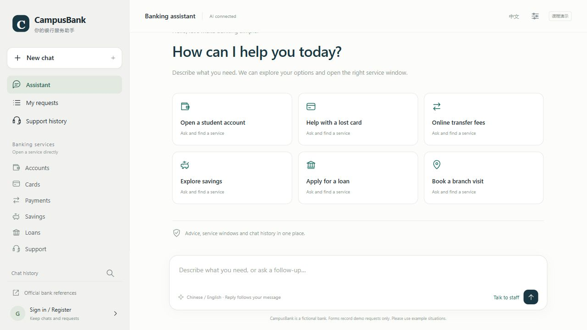
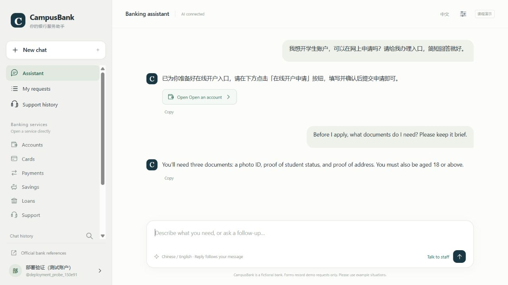
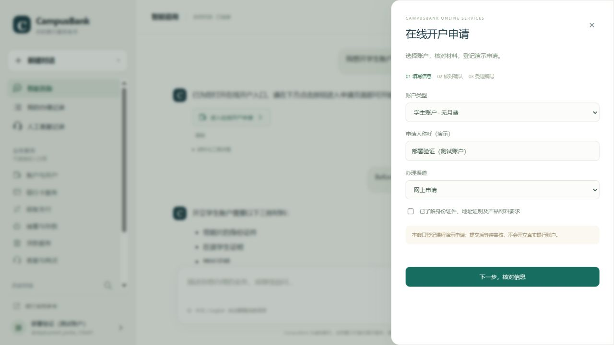
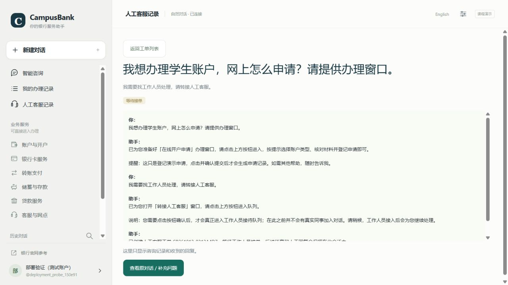
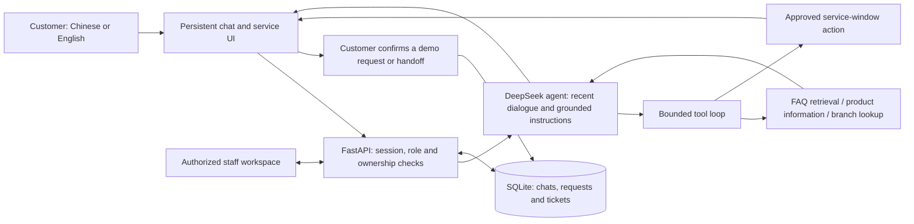

# CampusBank — Bilingual AI Banking Service Portal

[](https://github.com/hogomex393-svg/campusbank-ai-portal/actions/workflows/cloud-ci.yml)


**A conversational service interface that connects natural-language questions, grounded AI answers, guided service windows, and human support in one persistent conversation.**

[Live demo](https://campusbank-production.up.railway.app/) · [Interaction design](docs/interaction-design.md) · [Architecture](docs/architecture.md) · [Evaluation](docs/evaluation.md) · [Research directions](docs/research-directions.md)

[中文介绍](README.zh-CN.md)

CampusBank explores a practical interaction problem: **how can a user move from asking a question to completing the next service step without losing context or confusing AI with human staff?** The project combines a DeepSeek-powered bilingual agent with a multi-user web portal, an approved service catalog, and a separate staff workbench.

The hosted demo uses invitation-based registration; contact the project owner for access. You can also run the complete portal locally in offline mode without an API key. Hosting availability depends on the current Railway plan.

> CampusBank is a fictional educational prototype. Its products, fees, branches, applications, and transfers are synthetic. Service windows record demonstration requests; no real bank account or financial transaction is connected.

## What the interface does

| Interaction | Implemented behavior |
| --- | --- |
| Natural dialogue | Understands free-form questions and follow-ups, asks focused clarifications, and generates answers from knowledge and tools in online agent mode. |
| Bilingual conversation | Detects Chinese or English for each message. Users can change language within a conversation; neutral replies such as a city name inherit context. |
| Persistent history | New conversations retain earlier chats. Account-linked messages, titles, support context, and service records survive page reloads and server restarts when storage is retained. |
| Answer-to-action transition | Relevant answers can include approved service buttons. Forms guide users through entry, review, confirmation, and a recorded receipt. |
| Human handoff | A chat button creates a ticket with the current conversation. Customer follow-ups and genuine staff replies remain in that conversation. |
| Role-aware workspaces | Customers view their own support records. Authorized staff claim tickets and send replies; resolved tickets are read-only. Backend checks enforce these distinctions. |
| Shared support queue | Customers and staff can use different computers. Visible pages synchronize every three seconds; incoming updates preserve a staff member's unfinished reply. |

The sidebar groups nine service windows into **Accounts, Cards, Payments, Savings, Loans, and Support**. Users can enter a service directly or reach it through the conversation.

## Interface preview



The same conversation can switch from a Chinese service request to an English follow-up while retaining the earlier answer and service button.



An approved service action opens a guided form with separate entry, review, and confirmation stages.



The customer support view keeps the request context visible and exposes customer actions. Staff reply controls belong to the staff workspace.



Screenshots show the deployed prototype and a synthetic verification account. They contain no real customer records.

## How AI connects to the interface



The online agent uses the DeepSeek Chat Completions API and four tools: `search_bank_faq`, `get_product_info`, `find_branch`, and `open_service_window`. Bank-specific facts come from structured local records. Opening a window returns an allowlisted UI action; the model does not submit a form or approve a transaction.

FAQ retrieval combines word and character TF-IDF similarity across English and Chinese questions and aliases. The model receives recent conversation context, while the portal retains the full visible history. Tool calls, source IDs, token usage, latency, actual response mode, and sanitized failures are recorded with replies for inspection.

Online **agent**, retrieval-augmented **RAG**, model-only **LLM**, and API-free **offline** modes support comparison. Offline mode uses deterministic retrieval/dialogue logic. If an online call fails, the fallback is labeled in response metadata.

## Verification evidence

| Check | Recorded result | Scope |
| --- | --- | --- |
| Python suite | **82 tests passed** | Account/session behavior, tool and language logic, history, support ownership, roles, cloud settings, quotas, and recovery. |
| Frontend workflow checks | Offline DOM assertions passed | History retention, service forms, customer/staff controls, handoff, polling updates, preserved drafts, and escaping; HTTP is mocked. |
| FAQ retrieval | **72/78 Hit@3 (92.3%)** | Authored benchmark, offline run on 2026-10-14; two of 80 questions are not retrieval-scorable. |
| Offline response proxy | **57/80 (71.25%)** | Lexical key-point matching; this is not a factual accuracy or usability score. |
| Bilingual online regression | **10/10 language checks**, 18 API calls, one successful correction, no recorded errors | Authored DeepSeek regression on 2026-10-14, including the observed failure scenario; not a general quality estimate. |
| Hosted deployment | HTTPS, live DeepSeek responses, handoff creation, customer read-only support history, and restart persistence checked | Recorded deployment smoke checks; no claim of continuous availability. |

The evidence and limitations are described in [Evaluation](docs/evaluation.md). A live language-following failure was identified and addressed in version 2.2.2 with output validation and one bounded correction. The original failure and the post-fix regression are both documented. These are engineering checks and authored regression cases. No independent participant study, model training, or peer-reviewed research result is claimed.

## Run locally

Use Python **3.13**. From the repository directory:

**Windows PowerShell**

```powershell
py -3.13 -m venv .venv
.\.venv\Scripts\python.exe -m pip install -r requirements-web.lock.txt
Copy-Item .env.example .env
.\.venv\Scripts\python.exe -m bankbot.web --port 8501
```

**Linux / macOS**

```bash
python3.13 -m venv .venv
.venv/bin/python -m pip install -r requirements-web.lock.txt
cp .env.example .env
.venv/bin/python -m bankbot.web --port 8501
```

Open [http://127.0.0.1:8501/](http://127.0.0.1:8501/) and keep the server terminal running. Choose **offline** answer mode for an API-free demonstration.

For online dialogue, enter your own `DEEPSEEK_API_KEY` in `.env` and select a model available to your account. The recorded online verification used `deepseek-v4-pro`. API requests can incur charges. The key stays on the server and must never be committed.

On a fresh **local** database, the first registered account receives owner capabilities. Create that account yourself before inviting other people. Use its staff role and invitations to set up a separate staff account. Subsequent customers cannot grant themselves staff permissions. For a two-role demonstration, use separate browsers or computers, since tabs in one browser share cookies.

Cloud deployment has a separate initialization mechanism: the first customer never becomes an administrator. See [Deployment and accounts](docs/deployment.md) for private bootstrap codes, invitation-based access, persistent storage, and a LAN demonstration.

## Reproduce checks

With your virtual environment's Python:

```bash
python -m pip install httpx==0.28.1
python -m unittest discover -v
python -m evaluation.run --mode offline
```

The evaluation writes fresh results under `evaluation/results/`, which is excluded from Git. Frozen reference results are under `docs/evidence/`.

Frontend checks additionally require Node.js 24:

```bash
npm install --no-save --prefix .build_frontend jsdom@30.1.2
node scripts/verify_frontend.mjs
```

The [GitHub workflow](.github/workflows/cloud-ci.yml) also builds the Docker image and verifies account, support, and persistence behavior in a disposable container. Online evaluation is opt-in and uses your configured API account.

## Repository guide

| Path | Purpose |
| --- | --- |
| `web/` | Browser interface, conversation rendering, role-aware controls, service forms, and polling. |
| `bankbot/web.py`, `portal_store.py` | API authorization, sessions, ownership, persistent chats, requests, and tickets. |
| `bankbot/service.py`, `llm_client.py`, `tools.py` | Model orchestration, DeepSeek transport, bounded tool execution, and service actions. |
| `bankbot/retrieval.py`, `language.py`, `dialogue.py` | FAQ ranking, language detection, context, and offline dialogue. |
| `data/`, `evaluation/`, `tests/` | Synthetic domain knowledge, authored benchmarks, reproducible evaluation, and automated checks. |
| `docs/` | Interaction rationale, architecture, evidence, deployment instructions, and prospective research. |

## Project background

**Maintained by Zhou Yuxi.** The project began as a six-person CNSCC324 coursework assignment (Lab Class 1, Team 12) and was extended into this interactive portal. Its interaction requirements include natural dialogue, persistent history, service entry points, account roles, human handoff, and shared customer/staff workflows.

[Development process](docs/development-process.md) describes the design iterations. [Research directions](docs/research-directions.md) outlines proposed experiments for evaluating the interface and agent behavior.
