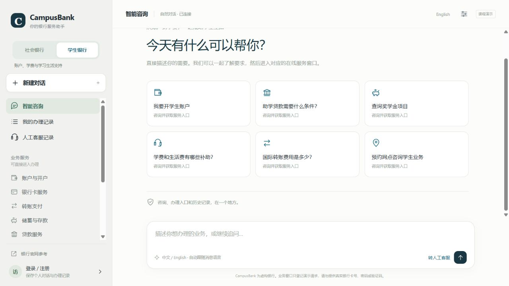
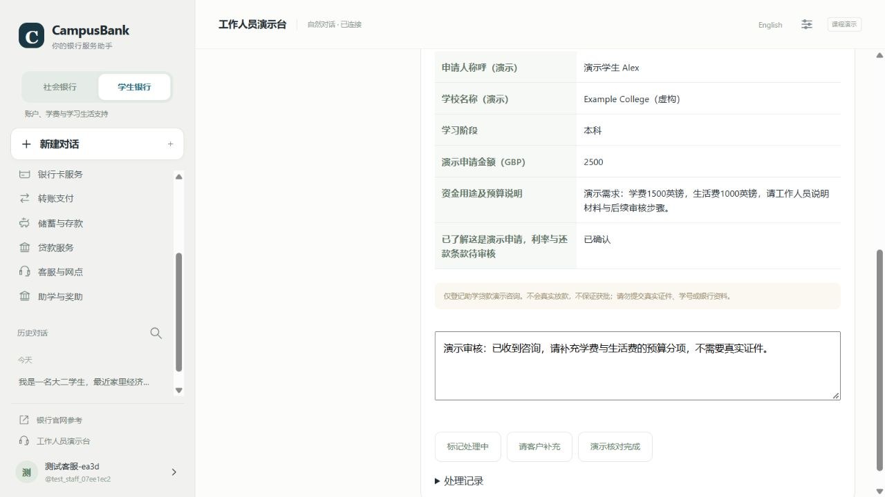

# General and student banking — version 2.4.0

The portal now offers **General banking** and **Student banking** as two service focuses. Switching focus starts a separate conversation while retaining existing history. Opening an earlier conversation restores its saved focus. Account ownership, language choice and staff/customer roles remain separate concepts.

## Student services

Student banking adds an education-finance category, a student-loan enquiry form, and a filterable scholarship/grant directory. The directory contains four explicitly fictional programs: tuition/living-cost lending, an academic scholarship, a study/living grant and emergency support. The amounts, documents and terms illustrate the coursework workflow; they do not represent real government or university policies. Loan rates and repayment terms are left for review rather than copied from the personal-loan product.

Students can browse by study level and funding type, ask questions in chat, and submit a demo enquiry for staff follow-up. General banking focuses its welcome suggestions on everyday accounts, payments, cards, savings and personal loans. Shared banking services are still available when relevant.

## Complete answers and next-question chips

The response budget increased from 500 to 1,600 tokens per model call, and the instructions ask for relevant explanations, document requirements, unknown terms and practical next steps. Short greetings and genuine clarifications remain short.

A separate presentation defect was corrected: some providers put a substantive explanation in an assistant message that also calls a tool, then finish with a short window acknowledgement. The portal used to show only that final acknowledgement. It now combines the user-facing explanation and final answer once, while excluding tool JSON and private reasoning content. Paired tool messages remain valid in saved model history.

Up to three contextual next-question chips appear below the latest AI answer. Clicking a chip sends that question in the same conversation; it does not submit a form or assume an eligibility decision. Suggested questions follow the turn's Chinese/English language and avoid exact repeats already asked. The AI does not insert suggestions into an active human-support conversation.

## Staff access during testing

`BANKBOT_OPEN_STAFF_TESTING` defaults to `false`. With this explicitly enabled, the sign-in dialog and customer profile offer a one-click test-staff entry. Staff registration/sign-in also needs no invitation during this mode. Existing account passwords are still checked; the one-click entry creates a separate test session instead of bypassing someone else's password.

Temporary staff capability is attached to the session, without granting new administrator rights or persisting permanent staff membership. Turning the flag off and restarting/redeploying revokes those temporary staff sessions and restores invitation-based staff access. Private bootstrap and administrator-only invitation/import actions remain separate.

The currently hosted group-testing deployment intentionally enables this flag, so the test staff workspace can read the portal's submitted demo applications. Keep this stage limited to demonstration data.

## Application workbench

The staff workspace has two tabs: **Support tickets** and **Applications and forms**. The latter shows submitted account, card, transfer, savings, loan, appointment, digital-help and education-finance forms. Staff can filter by banking focus and status, read labeled form values, and record processing, information-needed or completed-demo-review states.

Review notes and an audit history are stored in SQLite. Customers see the status and note on their own My requests page. Customer endpoints retain ownership checks; staff endpoints require the active staff role. Application completion is a demo review state, never a real transfer, credit decision or account opening. Visible staff queues poll every three seconds and retain unfinished review notes.

## Provider configuration

DeepSeek remains the tested provider. The interface now accepts `LLM_PROVIDER`, `LLM_API_KEY`, `LLM_BASE_URL`, `LLM_MODEL` and `LLM_MAX_TOKENS`. Legacy `DEEPSEEK_*` configuration still works. `.env.qwen.example` provides an optional Qwen configuration: use an API key and endpoint from the same Model Studio region, with the exact workspace endpoint from the console.

Qwen uses `enable_thinking=false`; DeepSeek uses its own `thinking` field; the generic compatible option sends neither. A DeepSeek key is never silently reused for Qwen. Provider transport is covered by mocked-payload tests; a live Qwen benchmark is not claimed because no Qwen credentials were supplied.

Official references: [Model Studio compatible API](https://www.alibabacloud.com/help/en/model-studio/compatibility-of-openai-with-dashscope), [recommended models](https://www.alibabacloud.com/help/en/model-studio/models), [DeepSeek generation limits](https://api-docs.deepseek.com/api/create-chat-completion/).

## Validation scope

Automated checks cover saved mode/history, student-source grounding, contextual suggestions, reversible test access, password checks, customer/staff separation, application review visibility, larger output settings and provider-specific payloads. Frontend DOM checks additionally exercise the mode switch, directory filters, chip clicks, one-click staff entry, live request views and customer notes. Browser inspection uses synthetic records only. These are engineering regressions rather than a user study or general model-quality ranking.

Current validation: **102 Python tests passed**, frontend DOM assertions passed, and [four authored online cases](evidence/dual_mode_online_v2.4.json) passed the declared checks using DeepSeek with a 1,600-token per-call output budget. Length is an observation, not a general quality metric.
