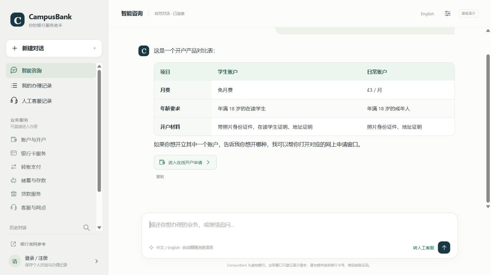
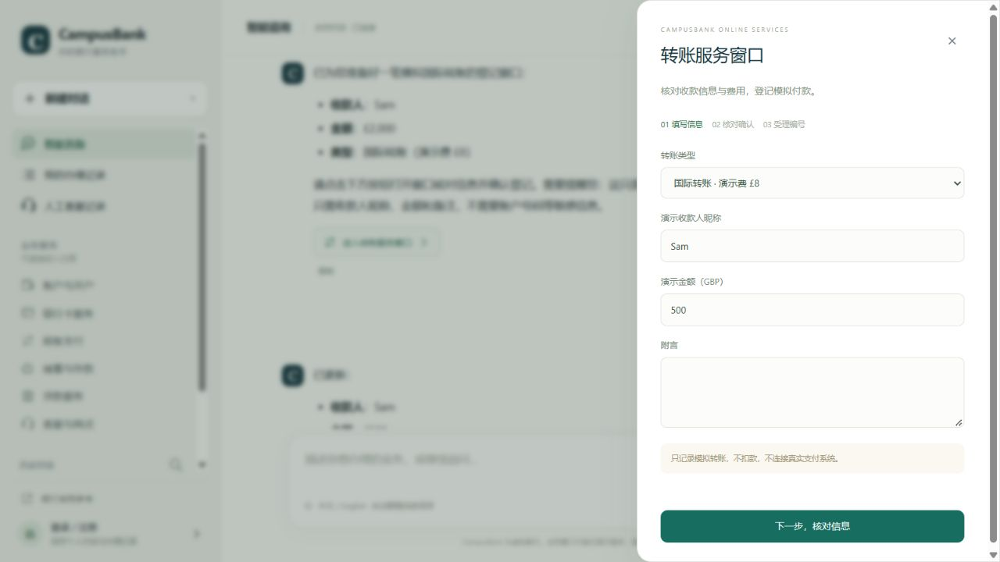

# Dialogue, form and readability fixes — version 2.3.0

Verified on 2026-10-20 using synthetic cases. This release addresses dialogue/form inconsistencies and presentation problems identified during group testing.

| Reported problem | Change | Verification |
| --- | --- | --- |
| A transfer mentioned in chat opened an empty/default form. | The approved window tool accepts partial form fields. Per-conversation drafts retain type, recipient nickname and amount, and old buttons open the latest draft. | International transfer to Sam, GBP 2,000 → change to GBP 500; the actual browser form retains international/Sam and shows 500. |
| Appointment edits lost other details. | Draft patches update one field while keeping previously supplied city/date/purpose. | London / 2026-11-02 / student-account enquiry → Manchester; date and purpose retained. |
| Double confirmation created duplicate requests. | Confirmation disables immediately; a persistent per-owner idempotency record returns the same receipt for the same request key. Reusing a key for different details is rejected. | Four concurrent backend submissions produce one record; browser double-click produces one POST; replay after reopening the database returns the same receipt. |
| Past dates and blank descriptions reached confirmation. | Frontend checks trimmed required fields and the server's current UTC date; backend independently enforces both. | Invalid date and whitespace cases rejected in UI and API; English errors checked. |
| Compound questions lost documents/fees/procedures. | Gather requested policy attributes independently, include structured evidence for agent/RAG, and combine relevant facts in offline mode. | Chinese documents/monthly-fee/online-entry and English documents/international-fee cases. |
| Assistant described unsupported app or payment operations. | Knowledge and instructions match the actual demo catalog. Transfer drafts use nickname/amount/type/note only. Missing minimum policy remains not specified. | Synthetic lost-card, missing-minimum and transfer-field cases. |
| English interface mixed untranslated forms/settings. | Catalog descriptions, notices, labels, choices, static dialogs and API errors have English text. Internal option values use readable labels in saved details. | DOM checks cover all nine forms and settings; browser inspection supplements them. |
| Network and rate-limit errors were difficult to act on. | Preserve input, provide a retry button, reuse the original message ID, and display the server's retry countdown. | Mock interrupted fetch and HTTP 429 checks. |
| Searching no history matches showed the wrong empty state. | Separate no matching conversations from a new account's empty history. | DOM regression. |
| Answers exposed Markdown table separators. | Render semantic HTML tables with headers, row labels, alternating backgrounds, safe inline formatting and a local horizontal scroll container. | Real model-generated comparison viewed in desktop and 390px mobile layouts; escaping and fenced-table regressions. |

## Evidence

- **93 Python tests passed**, including eleven added review regressions.
- [Frontend workflow assertions](evidence/frontend_workflows_v2.3.json) passed with mock HTTP, including table rendering, stale-button draft refresh, duplicate clicks, validation, English catalog/settings, input recovery and countdowns.
- [Ten authored online turns](evidence/review_v2.3_online.json) passed their declared lexical/draft checks using **16 actual API calls**, with no recorded online failures. This is a focused regression, not a general accuracy or user-satisfaction estimate.
- [The 80-question offline benchmark](evidence/offline_queries_v2.3.json) was rerun: 72/78 Hit@3 and 57/80 lexical key-point passes. Historical records are retained separately.
- At 390px, the page measured 390px wide while the comparison table scrolled inside its own 315px container. No page-wide horizontal overflow was observed in that state. See [mobile preview](assets/readable-comparison-mobile.png).

The external test reports are not published here; the repository contains new synthetic reproductions. No existing customer chats or requests are removed by this release. The SQLite change adds an idempotency table while retaining existing records. Request keys are scoped to the authenticated owner and are never authorization credentials.
