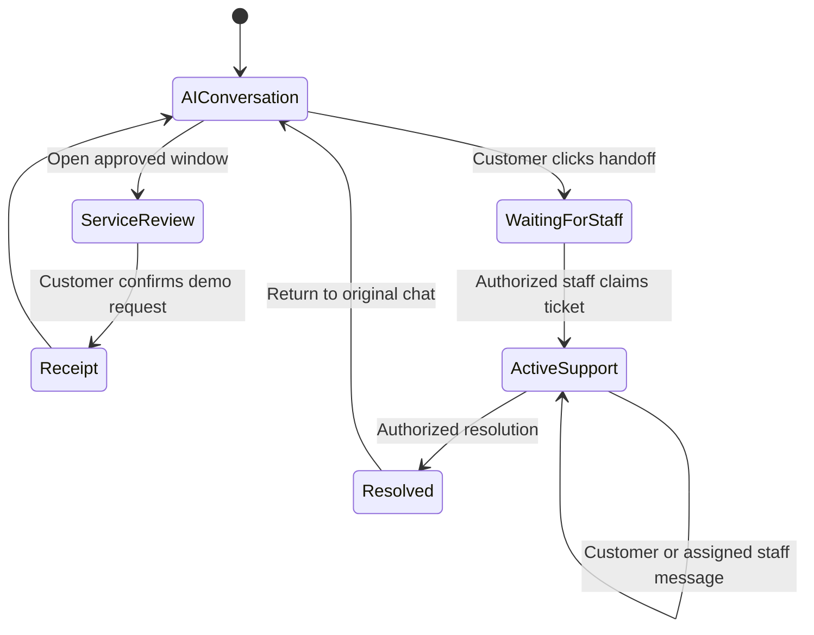

# Interaction design: from inquiry to service

## Design question

Banking inquiry interfaces often require users to translate a vague goal into a product category, repeat context in a form, and repeat it again to a human. CampusBank brings these steps into one portal. The initial coursework requirement was a human-like inquiry agent with simple dialogue; the portfolio extension adds continuity and accountable service actions.

## Interaction decisions and acceptance conditions

| Requirement raised during iteration | Design response | Observable acceptance condition |
| --- | --- | --- |
| Answers felt scripted when users phrased a goal differently. | Online agent interprets the goal and asks a focused clarification; structured facts support generated answers. | An ambiguous request such as “我想办张银行卡” can be clarified without forcing a fixed product menu. |
| Earlier messages disappeared after a later reply or a new conversation. | Persist every message and maintain an account-linked sidebar chat list. | Earlier turns remain visible; a new chat leaves the old chat selectable. |
| Chinese and English both need to work. | Determine response language per turn and inherit context for neutral replies. | A Chinese → English language switch changes the next answer's language. |
| Knowing the process is not enough; users need an entry point. | Return approved service buttons beside answers and expose business categories in the sidebar. | A button opens the relevant form; submission requires review and confirmation. |
| A user should request a person within normal chat. | Create a context-linked ticket from the handoff button. | The ticket includes the prior conversation and later customer messages. |
| Customers must not see controls for answering as staff. | Separate active customer/staff roles and check permissions on every staff endpoint. | Customer support history has no staff reply box; direct unauthorized API calls are rejected. |
| Staff and customers use different computers. | Central SQLite-backed queue with three-second polling. | New messages synchronize, and polling does not clear an unfinished staff reply. |
| Closed support records should remain readable. | Resolved tickets display a transcript without reply actions. | Users can reopen the original conversation; the closed record remains read-only. |

## Main user journey

1. **Ask naturally.** The user describes a goal, for example opening a student account. The assistant can ask a useful clarification and preserve the answer as context.
2. **Receive grounded guidance.** Product facts or FAQ results inform the explanation. Chinese and English can be mixed across turns.
3. **Choose the next action.** A service button opens a catalog-controlled window. The user checks the information and explicitly confirms a fictional request.
4. **Request human support if needed.** The chat offers a handoff button. A ticket carries the conversation to the staff queue.
5. **Continue in context.** While the ticket is waiting or active, customer messages go to the support conversation and the AI pauses. Actual staff messages are labeled separately.
6. **Return to the record.** The conversation and resolved support context remain accessible later.

## Customer and staff affordances

The customer view shows ticket status and transcript, with links to the original chat and follow-up context. The staff workspace adds claim, reply, and resolution controls where permitted. A staff-capable account can select its active role; capability alone does not expose staff operations in customer mode. The backend applies the same distinction, preventing a hidden-button-only implementation.

## Boundaries

The current page labels and forms contain partial Chinese/English localization; conversational output is bilingual. This is not a complete accessibility or localization audit. Three-second polling provides shared updates rather than push transport. The prototype has no real bank integration, payment processing, or production customer-service staffing.

These decisions arose from owner-led requirements and observed prototype behavior. They are not findings from a formal user study. Proposed evaluation tasks appear in [Research directions](research-directions.md).
