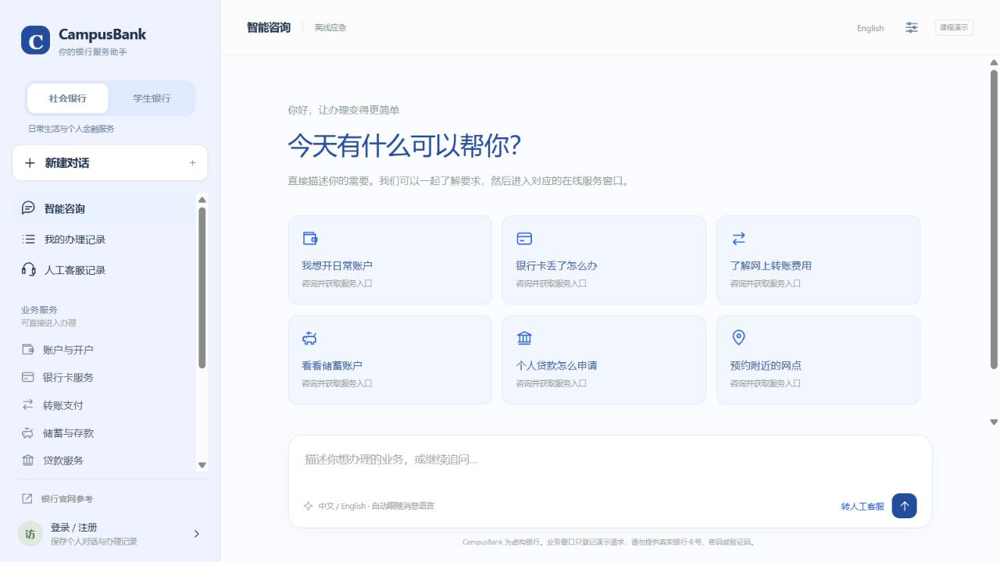
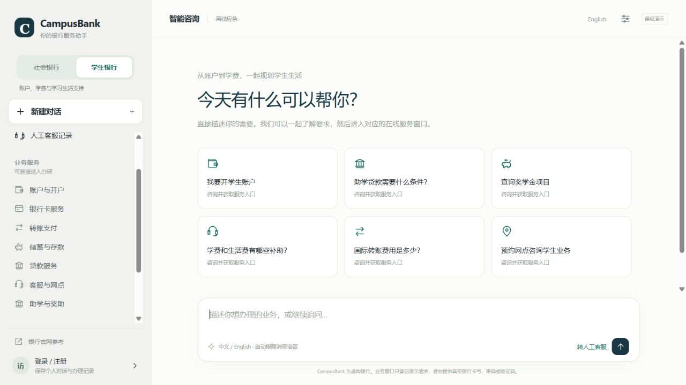

# Realistic fictional forms and banking themes — v2.5.0

Account opening and transfers now offer a fuller service journey: fill in the scenario, inspect the canonical review, confirm, and receive a request reference. General banking offers blue, ruby red, violet and navy previews in the sidebar; student banking retains green. The active mode changes the sidebar, headings, cards, conversation accents, buttons, forms and tables, and remains associated with conversation history. General palette preferences are saved in this browser; switching palettes preserves the current chat and composer text. Navy uses a dark sidebar with a light content area. New browsers start with ruby red.

## Reference journeys

The design follows the structure of official banking guidance, rather than copying a bank's branding or claiming to implement its services:

- [HSBC identity and address guidance](https://www.hsbc.co.uk/help/banking-made-easy/help-us-identify-you/) informs the distinction between identity and address evidence, and checking that application details agree with the documents.
- [HSBC current-account application guidance](https://www.hsbc.co.uk/current-accounts/what-do-you-need-to-open-a-current-account/) informs eligibility and application-information review.
- [NatWest payment guide](https://www.natwest.com/banking-with-natwest/how-to/make-payments.html) informs payee details, reference, amount, review and approval stages.
- [NatWest Confirmation of Payee guidance](https://www.natwest.com/support-centre/banking-from-home/make-payments/what-is-confirmation-of-payee-cop-and-how-does-it-work.html) informs the name-check explanation. CampusBank compares only its own fixed fictional records; it does not use the actual CoP network.

These pages explain real-world patterns. CampusBank's account criteria, charges, balances and exchange rates remain the project's fictional data.

## Account-opening journey

Select the product and application channel, then a fictional adult, student or international-student profile. The interface displays the profile's demo name, birth date, contact email, address and identity-record reference. Users choose employment/study status, account purpose, funding source, tax residence, identity evidence, address evidence, student evidence where applicable, and a debit-card preference.

The student product requires a student profile and study status. Documents marked as missing, or a tax-residence selection needing follow-up, create a `needs_info` application. Ready documents create a pending review request. This is readiness tracking, with no document upload, real identity check or account creation.

## Transfer journey

Select a fictional paying account and a domestic or overseas payee, edit the payee name for matching tests, enter the amount/reference and purpose, and optionally select a scheduled date. The selected fixture shows its bank, country, routing identifier and account identifier. All identifiers deliberately contain `DEMO` and are not valid payment credentials.

The server computes a canonical quote using decimal arithmetic. It displays principal, fee, total estimated debit, illustrative remaining balance and estimated recipient amount. For international transfers, it also displays the explicitly fictional fixed exchange rate. Existing fictional fees remain GBP 0 domestic and GBP 8 international; these are not charges from the referenced banks.

An unmatched name blocks review. A close name requires a separate acknowledgement. An insufficient fictional balance, an incompatible domestic/overseas payee, and an invalid/past scheduled date are rejected. The balance is a fixture and is never debited. A scheduled date is request information and does not schedule an actual payment.

## Persistence and compatibility

`POST /api/scenarios/preview` is a CSRF-protected, read-only calculation with no paid model calls or database writes. The final submit revalidates all scenario data and the person's explicit declaration. It recomputes the review independently, and rejects injected quote/account fields. Reusing a request identifier with modified scenario details returns a conflict.

SQLite receives an additive `scenario_json` column. Historical requests remain readable with a null scenario; the original minimal API payloads remain supported for legacy clients. New browser forms always include the richer scenario. No existing passwords, chats, tickets or requests are replaced. Customer history, receipts and the staff application workbench display the saved canonical scenario table.

## Validation

119 Python tests cover existing behavior plus canonical quotes, decimal rounding, fee-inclusive balance checks, name matching, declarations, scheduling, student eligibility, missing documents, CSRF, permissions, idempotency and old-database migration. Three DOM scripts cover existing workflows, streamed replies and the new form interactions, including English labels and preserved fields when returning from review.

