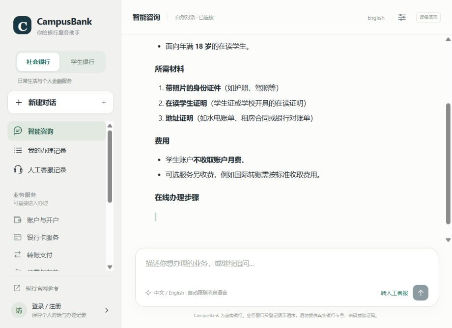

# Streamed answers — v2.4.1

The chat displays answer text while the model is still generating it. The API adapter requests a streamed completion, reconstructs tool-call fragments internally, and forwards only public answer content to the portal. The browser applies a short progressive reveal to smooth bursts of received text.

The reply has three visible stages: a thinking/checking indicator, progressively rendered text with a cursor, and the final message with service actions, follow-up questions, and copy controls. Table headers wait for a valid separator before rendering, so incomplete table syntax does not flash as plain text. Tables retain the existing horizontal scrolling behavior.

The entire answer is saved in the same persistent conversation as before. The final event is emitted after saving; returning to the conversation shows the complete message. If a provider error or language correction changes the answer, a replacement event reconciles the partial display with the final saved text. An interrupted browser connection does not cancel an already-started server generation. Retrying the same send identifier retrieves the saved result or waits for the current operation, avoiding a second model call.

## HTTP protocol

`POST /api/chats/{id}/stream` accepts the same JSON body and CSRF header as `/messages`, and returns `text/event-stream`. It checks session, ownership, origin and message validation before streaming. Paid-call quotas remain enforced; in-stream failures carry a sanitized error and, for quotas, a retry delay.

| Event | Payload and meaning |
| --- | --- |
| `start` | Connection established. |
| `status` | A short public progress label while tools run. |
| `delta` | Append `text` to the current answer. |
| `replace` | Replace partial text with a corrected or fallback answer. |
| `complete` | Canonical saved `chat`, including final metadata and approved UI actions. |
| `error` | Sanitized `detail`, `status`, and optional `retry_after`. |

Ten-second heartbeat comments keep idle connections active. Headers disable caching and proxy transformations. The original JSON endpoint remains available for older browsers and CLI/integration clients. Older browsers still progressively reveal the final JSON answer.

## Verification

- 109 Python tests cover the existing portal plus SSE content/tool reconstruction, private reasoning separation, incomplete-stream errors, fallback replacement, permissions, persistence, idempotency and quota retries.
- `node scripts/verify_frontend.mjs` checks existing customer/staff workflows with progressive rendering enabled.
- `node scripts/verify_streaming.mjs` checks text visible before completion, deferred actions, partial tables, split Chinese/emoji UTF-8 bytes, CRLF framing, and interrupted/error events.
- A local HTTP probe using the configured DeepSeek API received 374 text events: first answer text at 1.027 seconds and completion at 6.798 seconds. The 651-character saved answer matched the received stream. These are observations from one synthetic query, not a latency benchmark or guarantee.
- The deployed Railway endpoint received 347 text events in another synthetic query, with first text at 1.770 seconds and completion at 8.895 seconds. The 631-character saved reply matched the stream; retrying its send identifier returned the same record. Deployed JavaScript and CSS hashes matched the tested source.
